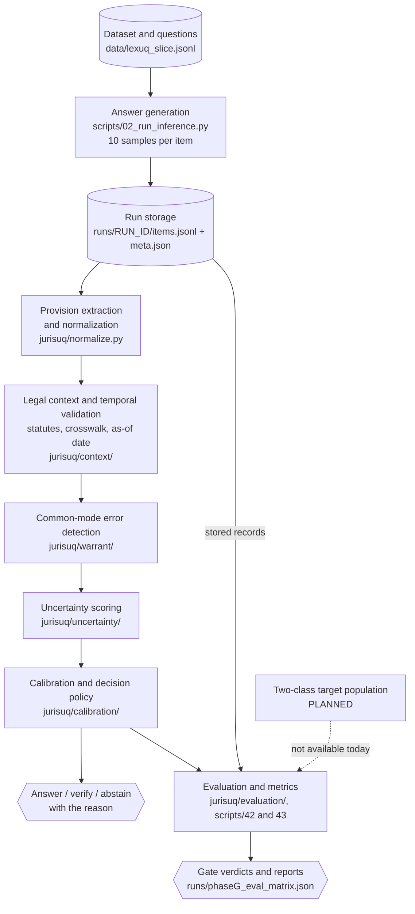

# JURIS-UQ

**Legal-aware uncertainty quantification for LLM-based Indian legal question
answering.**

JURIS-UQ is a research prototype that studies whether *agreement among an LLM's
repeated samples* is a trustworthy signal of *legal* correctness. It builds a
matched benchmark around the Indian Penal Code (IPC) → Bharatiya Nyaya Sanhita
(BNS) transition, decomposes observed agreement into the part that legal context
supports and the part it does not, and turns the residual into a calibrated
risk score, a decision policy, and a set of pre-registered evaluation gates.

> **Scope.** JURIS-UQ is not a legal service and does not provide legal advice.
> Its benchmark is one synthetic 200-item matched construction, its results come
> from one quantized 7B checkpoint, and independent human legal review of the
> legal annotations is still pending. Implementation completeness and scientific
> validation are reported separately throughout this document.

| | |
|---|---|
| Research object | agreement under repeated sampling as a proxy for legal correctness |
| Benchmark | 200 paired items around the 1 July 2024 IPC → BNS transition (100 L1 / 100 L7) |
| Model of record | `qwen2.5-7b-instruct`, local OpenAI-compatible endpoint, 10 samples per item, frozen |
| Gate state | G1 PASS · G2 NOT YET · G3 NOT MET · G4 PASS · G5 `NOT_EVALUABLE` · G6 `NOT_MET` · G7 `NOT_MET` · pilot `ON_HOLD` |
| Test suite | 645 passed, 1 skipped (2026-10-27, Python 3.11.2, CPU-only) |
| Authoritative status | [`STATUS.md`](STATUS.md) · order of work: [`ROADMAP.md`](ROADMAP.md) |

---

## Contents

1. [Research problem](#1-research-problem)
2. [Research questions and contributions](#2-research-questions-and-contributions)
3. [Architecture](#3-architecture)
4. [Methodology and data flow](#4-methodology-and-data-flow)
5. [Current implementation versus intended system](#5-current-implementation-versus-intended-system)
6. [Results and gate status](#6-results-and-gate-status)
7. [Repository structure](#7-repository-structure)
8. [Installation](#8-installation)
9. [Configuration and model provider](#9-configuration-and-model-provider)
10. [Running tests, offline validation and real experiments](#10-running-tests-offline-validation-and-real-experiments)
11. [Evaluation methodology and metrics](#11-evaluation-methodology-and-metrics)
12. [Datasets, legal sources and provenance](#12-datasets-legal-sources-and-provenance)
13. [Reproducibility and artefact management](#13-reproducibility-and-artefact-management)
14. [Limitations and open blockers](#14-limitations-and-open-blockers)
15. [Ethics and legal considerations](#15-ethics-and-legal-considerations)
16. [Documentation and references](#16-documentation-and-references)

---

## 1. Research problem

### 1.1 Repeated agreement is not legal correctness

Uncertainty quantification for free-form LLM output usually rests on variation:
sample the model several times and treat disagreement as uncertainty. The
approach assumes errors are idiosyncratic — that independent samples fail
independently. Legal question answering violates that assumption. A model that
believes theft is still punishable under IPC 379 will say so loudly, coherently,
and in ten samples out of ten. Entropy is zero, self-consistency is perfect, and
the answer is wrong because the provision was repealed.

We call this a **common-mode legal error**: a systematic error shared by every
sample, and therefore invisible to any uncertainty signal computed from sample
variation alone. The diagnostic quantity is

```text
CM = A - W
```

where `A` is observed agreement (the modal cluster's share) and `W` is
*agreement the legal context can warrant*. On a slice where every sample asserts
a repealed provision, `A = 1` and `W = 0`, so `CM = 1`: unanimous, coherent, and
legally unsupported.

### 1.2 Why the IPC → BNS transition

The Bharatiya Nyaya Sanhita replaced the Indian Penal Code with effect from
1 July 2024 (BNS §1(2); §106(2) commenced later, on a date fixed by
notification). A model trained before that date, or one that simply prefers the
code it saw most often, answers post-transition questions with the repealed
provision. The transition therefore gives the project a *matched, dated* legal
change whose effect on model behaviour can be measured without inventing one.

The benchmark is built from matched pairs:

| Slice | Question asks for | Gold | Trap |
|---|---|---|---|
| **L7** | the law in force *now* (on/after 1 July 2024) | the BNS provision | the repealed IPC provision |
| **L1** | the law *immediately before* the transition | the IPC provision | the BNS successor |

Each pair shares an offence, a fact pattern and a template, so the only thing
that moves between L1 and L7 is the legal regime and the temporal direction of
the trap. That is what makes L1 a control: an IPC citation is *correct* there
and *stale* on L7.

This is also why the problem cannot be reduced to string matching. An answer can
name the right section with the wrong subsection, cite the right section under
the wrong (repealed) act, assert a provision that exists but was not in force at
the question's as-of date, or assert provisions that contradict each other at
rule level. Resolving any of these requires a statute store with validity
windows, an IPC/BNS crosswalk, and a jurisdiction declaration — not a regex.

### 1.3 What legal-aware uncertainty is meant to add

Sample variation answers *"would the model answer differently if asked again?"*.
JURIS-UQ additionally asks *"is the agreement it does have supported by the law
in force at the date the question asks about?"*. The detector therefore
decomposes agreement into four separately reported factors — agreement,
temporal validity, jurisdiction fit and contradiction mass — and composes them
into a warranted-agreement score. Every factor is kept separate so a failure can
be attributed to one of them rather than to an opaque product.

### 1.4 What this project does not claim

- It is **not** a legal correctness oracle, a legal research service, or legal
  advice.
- It does **not** establish that legal-aware uncertainty beats sample-only
  uncertainty in general. On the current frozen slice, the legal factors have no
  within-slice variance, so the comparison is not evaluable at all (§6.6).
- It does **not** provide a cross-model comparison. The Qwen3-14B material is a
  screening and a limited diagnostic, not a multi-model evaluation.
- It does **not** carry human legal verification. Every legal annotation is
  machine-checked and marked `PENDING_HUMAN_REVIEW`.

---

## 2. Research questions and contributions

The project is organised around one hypothesis and five operational questions,
each tied to a gate that must be passed with stored evidence before the next
stage is admissible.

**Hypothesis.** Agreement among samples is not evidence of legal correctness when
the underlying error is systematic, and legal context (validity in time,
jurisdiction, typed relations between asserted provisions) can separate
*repeated* agreement from *warranted* agreement.

| ID | Question | Gate | Answer today |
|---|---|---|---|
| RQ1 | Does sample-level agreement hide legally wrong answers on the transition slice? | G1 | **Yes, under this construction** — L7 accuracy 0.000; 16/100 items unanimous *and* wrong |
| RQ2 | Do typed legal relations change the error structure enough to rescue unanimously-wrong clusters? | G2 | **Not yet** — the relation model improves, but the required rescue count is 0 |
| RQ3 | Does the legal-aware score rank errors better than sample-only scores on the target slice? | G5 | **Not evaluable** — the L7 arm has a single correctness class |
| RQ4 | Can a calibrated score support a harm-weighted answer / verify / abstain decision within stated limits? | G6 | **No, not met** — ACE 0.2797 against a 0.05 limit; selective risk worse than the sample-only baseline |
| RQ5 | Does an evaluation population exist on which the headline comparison is computable? | G7 | **No** — no target slice on which a ranking is defined |

**Contributions, as far as the evidence supports them.**

1. A **matched IPC/BNS transition benchmark** with paired L1/L7 items, explicit
   as-of dates, and a gold/trap construction that makes the temporal direction
   of the trap symmetrical.
2. A **deterministic legal context layer**: a 48-row statute store with validity
   windows, a 20-row IPC/BNS crosswalk, and immutable context packs attached to
   stored runs.
3. A **common-mode detector** whose temporal factor attributes errors to the
   transition itself: separation AUROC 0.9412 (95 % CI [0.8529, 1.0000]), and
   pinning the temporal factor to 1.0 removes the entire above-chance signal
   (drop 0.4412).
4. A **negative result worth recording**: on this slice the legal-aware
   uncertainty score cannot beat the sample-only baseline, *by construction*,
   because the temporal factor is constant within slice. This is a statement
   about the instrument and the population, not a tuning failure (§6.6).
5. An **offline evaluation matrix and deployment measurement harness** that
   covers all nine declared uncertainty methods — computing seven from frozen
   runs, naming the two it cannot compute — reports every undefined value with a
   reason code, and refuses to pool slices.

---

## 3. Architecture



Cylinders are stored data (dataset, run outputs, statute rows under `data/`), rectangles are processing modules in `jurisuq/` and `scripts/`, hexagons are final outputs. Every label names the real module or file, so each stage can be traced to code. Solid arrows are implemented and tested; the one dashed arrow marks a dependency that is **PLANNED** — a two-class target population, which is why G5, the L7 half of G6 and G7 stay unmeasurable.

---

## 4. Methodology and data flow

The phases are cumulative: each consumes the stored artefacts of the previous
one and never recomputes them. That rule is what keeps the evidence auditable.

1. **Dataset and target-candidate construction.** `scripts/01_make_data.py`
   builds the matched 200-item slice from a seed and a fixed template set; the
   file regenerates byte-for-byte. Candidate target sets are authored separately
   in the same schema, with `provenance.verified = false` and
   `review.status = PENDING_HUMAN_REVIEW` enforced by
   `jurisuq/target/candidates.py` before any screening run is allowed to touch
   them. *Status: implemented; the frozen slice is complete.*
2. **Legal metadata and statute versioning.** `scripts/20_build_statutes.py`
   builds 48 provisions (24 IPC, 24 BNS) across the ten offence clusters the
   slice touches, each with an in-force window, a successor/predecessor field
   and a source. `scripts/21_attach_context.py` attaches immutable context packs
   to a stored run at a declared as-of date and jurisdiction. *Status:
   implemented; verification is source-compared, not human-approved.*
3. **Model sampling and prediction extraction.** `scripts/02_run_inference.py`
   issues `M` samples per item through the provider interface, records the
   prompt version, temperature, seed and model, and writes an immutable run
   directory. `jurisuq/normalize.py` extracts the asserted provision from each
   sample conservatively; anything unresolvable stays `None` and is never
   coerced into "stale" or "false". *Status: implemented; the frozen run of
   record exists and is not regenerated.*
4. **Provision normalisation and legal relation processing.** Samples are
   clustered under three representations — exact provision key, NLI entailment,
   and typed legal relations (SAME_PROVISION, LEGALLY_EQUIVALENT,
   CONDITIONALLY_EQUIVALENT, DIFFERENT_PROVISION, AMBIGUOUS, CONTRADICTORY,
   OUTDATED_PROVISION). *Status: implemented; the typed relation model is
   trained and evaluated, and `relations_v2` is the model of record.*
5. **Common-mode failure identification.** `scripts/23_detect_warrant.py`
   computes `A`, `T`, `J`, `K`, then `W = A·T·J·(1−K)` and `CM = A − W`, and
   raises the four registered flags. The as-of date is the item's, not the
   analysis date: that is what makes the detector silent on a correct
   pre-transition answer and loud on a stale current-law answer.
   `scripts/24_validate_warrant.py` computes E4 and Gate G4. *Status:
   implemented and passed for the L1/L7 contrast; 13 of 200 records remain
   undefined because a required factor is unresolved.*
6. **Uncertainty estimation.** `scripts/25_fit_uncertainty.py` fits a small
   monotone logistic head on development groups only; `scripts/26_estimate_uncertainty.py`
   scores a stored run through a label-blind path, falling back to normalised
   sample-only provision entropy when legal evidence is missing — never to zero.
   *Status: implemented; G5 is `NOT_EVALUABLE` because the L7 arm has one
   correctness class.*
7. **Calibration and decision policy.** `scripts/29_fit_calibration.py` fits
   per-stratum maps (isotonic, Platt for small strata) with grouped
   cross-validation; `scripts/30_apply_policy.py` applies the harm-weighted
   answer / verify / abstain rule with a split-conformal coverage layer. *Status:
   implemented and evaluated; Gate G6 is `NOT_MET`.*
8. **Held-out evaluation and comparison.** `scripts/42_build_eval_matrix.py`
   computes the §21.2 matrix on the frozen pair-grouped evaluation partition —
   the only partition on which every method is out of sample — and reports
   AUROC, AUPRC, normalised AURC, selective risk at 50 % coverage, ACE, ECE,
   Brier and reliability bins per slice, with an explicit reason code for every
   undefined cell. *Status: implemented; two declared methods are absent
   (lexical similarity is unimplemented, p_true has no stored log-probabilities).*
9. **Gate evaluation and reproducibility checks.** Gates are read from stored
   artefacts. `scripts/47_offline_check.py` re-verifies the frozen-input digests
   and re-runs the offline stages; `scripts/46_revise_target_candidates_v2.py
   --check` proves the committed v2 candidate set is exactly what its builder
   produces. *Status: implemented.*

---

## 5. Current implementation versus intended system

This section exists because "the code runs" and "the science is settled" are
different claims. The software is complete for Phases A–G; the science is not.

| Phase | Diagram layers | Software | Science | What is missing |
|---|---|---|---|---|
| A — sampling and common-mode diagnostic | A, B, C | `IMPLEMENTED`, `TESTED` | **G1 PASS**, scoped to one 7B checkpoint | nothing; the run is frozen |
| B — typed legal relations | B, D | `IMPLEMENTED`, `TESTED` | **G2 NOT YET** | an evaluation population containing a rescueable collision |
| C — statute store and context packs | B | `IMPLEMENTED`, `TESTED` | **G3 NOT MET** | encoder-level representation safety; human legal review |
| D — detector | D | `IMPLEMENTED`, `TESTED` | **G4 PASS** | 13 records with an unresolved factor |
| E — uncertainty | E | `IMPLEMENTED`, `TESTED` | **G5 `NOT_EVALUABLE`** | an evaluation slice with both correctness classes |
| F — calibration and policy | E, F | `IMPLEMENTED`, `TESTED` | **G6 `NOT_MET`** | the same population dependency, and a score that separates errors better than sample variation |
| G — population, matrix, deployment | G | `IMPLEMENTED`, `TESTED` | **G7 `NOT_MET`**, pilot `ON_HOLD` | a measured two-class target slice; a zero-cost provider |
| H — artefacts and hashes | H | `IMPLEMENTED` | — | — |

Intended but not built: an external-benchmark transfer arm (deferred on dataset
and licensing review), a second model or quantisation for a genuine cross-model
comparison (blocked by human legal review of the labels, by protocol
sequencing), an L7 calibration stratum (needs a two-class L7 run), and laptop
cascade latency plus peak-memory measurement (needs a target-machine run).

---

## 6. Results and gate status

Every number below is read from a committed artefact under `runs/`; the file is
named in each subsection. Nothing here is a projection or a re-run.

### 6.1 Gate table

| Gate | Question the gate asks | Verdict | Evidence |
|---|---|---|---|
| **G1** | does sample agreement hide legally wrong answers on the transition slice? | **PASS** (scoped) | [`PHASE-A.md`](PHASE-A.md) §Gate G1, `runs/phaseA-laptop-v2-rejudged/e1_report.json` |
| **G2** | do typed relations rescue unanimously-wrong clusters? | **NOT YET** | [`PHASE-B.md`](PHASE-B.md) §Gate G2 |
| **G3** | is the legal representation safe enough to build on? | **NOT MET** | [`PHASE-C.md`](PHASE-C.md) §Block 7b |
| **G4** | does the detector separate common-mode errors from idiosyncratic ones? | **PASS** | `runs/phaseA-laptop-v2-rejudged+ctx-r2+typed+warrant/warrant_validation.json` |
| **G5** | does the legal-aware score rank errors better than sample-only on the target slice? | **`NOT_EVALUABLE`** | [`PHASE-E.md`](PHASE-E.md) §6, `runs/phaseG_eval_matrix.json` |
| **G6** | is the calibrated decision layer within its calibration and selective-risk limits? | **`NOT_MET`** | [`PHASE-F.md`](PHASE-F.md) §7, `runs/phaseA-laptop-v2-rejudged+ctx-r2+typed+warrant+uq-exact+cal-r2/calibration_report.json` |
| **G7** | is there a target slice with both correctness classes and a computable headline comparison? | **`NOT_MET`** | `runs/phaseG_eval_matrix.json` → `gate_g7` |
| Pilot | is a provider-backed pilot admissible? | **`ON_HOLD`** | `runs/phaseG_pilot_status.json` |

A passing software test never moves a gate. Gates are computed from stored
runs and compared against pre-registered thresholds; changing a threshold to
obtain a pass is out of scope by protocol.

### 6.2 Phase A — sampling and the common-mode diagnostic (G1 PASS)

Run of record `runs/phaseA-laptop-v2-rejudged/`: `qwen2.5-7b-instruct`, prompt
`p2-structured`, 10 samples per item, temperature 1.0, seed 20261005, 2,000
stored samples, judge coverage 1.0000.

| Quantity | L1 control | L7 target |
|---|---:|---:|
| Items | 100 | 100 |
| Item accuracy | 0.4343 (95 % CI [0.3333, 0.5253]) | **0.0000** |
| Provision-level collision population | 17 items, accuracy 0.8824 | **16 items, accuracy 0.0000** |
| Confidently wrong (zero entropy, wrong answer) | 0.118 | **1.000** |

The L7 arm is the premise of the project: every unanimity collision in it is
wrong, while the matched control's unanimity is mostly right. Sample-only AUROC
on L7 is undefined because the slice contains one correctness class — the
strongest possible form of the ceiling condition.

### 6.3 Phase B — typed legal relations (G2 NOT YET)

`relations_v2` combines synthetic and observed Phase A pairs (1,520 kept;
918 / 294 / 308 train / dev / test) and was trained for 12 epochs in 5,980 s on
CPU. On its 308-pair test split, macro-F1 is **0.9942** against the 0.7941
exact-key baseline (margin +0.2001); `DIFFERENT_PROVISION`
precision / recall / F1 are 1.0000 / 0.9726 / 0.9861. Merge precision and recall
are 0.9753 / 1.0000 at `tau = 0.05`.

G2 is nevertheless **NOT YET**. Its required evidence is a unanimously-wrong
cluster that typed relations *rescue*; the rescue count is 0 in both slices, and
the gold/trap probe merges 0/10 (L1) and 1–2/10 (L7). Relation labels are
rule-generated, not human-annotated — a stated limitation, not a silent one.

### 6.4 Phase C — statute store and context packs (G3 NOT MET)

48 rows (24 IPC, 24 BNS) over 10 offence clusters, with validity windows and a
20-row crosswalk (10 `successor_of`, 10 `different_offence`; all 20 rows carry
`verified: false`). Context coverage is **0.689034** — 421 known of 611 unique
asserted-reference lookups; 190 unknown assertions remain unknown rather than
guessed. Table SHA-256:
`ef50705e99b3ba8de8287df0e289c3df2dd5a4f648ccd58bdb9a9afd2c682b18`.

G3 is **NOT MET**: no encoder earns a passing representation-safety claim. The
word `verified` in this table means *compared with a cited source*, not
*human-approved*; the rows are `PENDING_HUMAN_REVIEW`.

### 6.5 Phase D — the common-mode detector (G4 PASS)

`runs/phaseA-laptop-v2-rejudged+ctx-r2+typed+warrant/warrant_validation.json`:

| Condition | Value |
|---|---|
| Separation AUROC (n = 32 collision records) | **0.9412**, bootstrap 95 % CI [0.8529, 1.0000] |
| Temporal-factor ablation (pin `T = 1.0`) | AUROC falls to 0.5000; drop **0.4412** |
| Correct-item alarm rate vs wrong-item alarm rate | 0.000 vs 0.889 |

The detector defines `CM` for 187 of 200 records. The 13 undefined records are
reported as undefined, not imputed. Contradiction mass `K` uses the rule
channel, which inherits the crosswalk's unverified status (`K` is non-zero on
4/200 records).

### 6.6 Phase E — legal-aware uncertainty (G5 `NOT_EVALUABLE`)

The Phase E score combines sample statistics with the detector's `W`, `CM` and
flag fields through a small monotone logistic head; when legal evidence is
missing it degrades explicitly to a sample-only score
(`uq_score_mode = sample_only_degraded`) rather than silently substituting zero.
Four Block-5b sibling runs and the Block-6/r3 regressions are preserved as-is.

**Why G5 cannot be satisfied on this instrument.** The temporal factor is
constant within slice: `T = 1.0` on 94/94 resolvable L1 records and `T = 0.0` on
80/81 resolvable L7 records. With `J = 1` and `K ≈ 0`, `W = A` on L1 and `W = 0`
on L7, so `u_cm` is identically zero on L1 and the legal-aware components carry
no within-slice information. The exact-key L1-only result is therefore AUROC
0.8714 against a 0.8714 baseline, paired difference 0.0000 with interval
[0.0000, 0.0000]. No estimator, hyper-parameter or ablation on these fields can
change that; G5 needs a population where the detector both fires and stays
silent inside one slice, which is Phase G work.

### 6.7 Phase F — calibration and the decision layer (G6 `NOT_MET`)

Run of record `runs/phaseA-laptop-v2-rejudged+ctx-r2+typed+warrant+uq-exact+cal-r2/`.
Policy constants: `c_verify = 0.15`, `c_abstain = 0.35`, harm weights 1.0–5.0
by offence cluster, coverage target 0.80.

| G6 condition | Threshold | Measured | Verdict |
|---|---|---|---|
| Calibration quality, development cross-fitted | ACE ≤ 0.05 | **0.2797** (L1, n = 78) | FAIL |
| Harm-weighted selective risk at 50 % coverage | below every baseline | **0.5455** vs 0.4545 (sample-only) | FAIL |
| Conformal empirical coverage | ≥ target − tolerance | 0.6818 ≥ 0.80 − 0.1671 | pass |
| No labels on the query path | static check | label-blind | pass |
| Target stratum evaluable | both classes | L7 has 0 correct of 100 | not evaluable |

Two structural notes are recorded with the run. A monotone calibration map
cannot change the ranking, so the calibrated score's selective risk equals the
raw score's *by construction*; only a different score is an informative
baseline. And on this slice every offence cluster resolves to `custodial`, so
harm weighting is a constant multiplier. The conformal threshold in the run of
record is fitted on development and its coverage measured on the holdout: an
earlier sibling run fitted the threshold on the same items it measured, and that
is corrected in `+cal-r2` without changing the verdict
([`PHASE-F-FOLLOWUP.md`](PHASE-F-FOLLOWUP.md)).

### 6.8 Phase G — target population, evaluation matrix and the pilot (G7 `NOT_MET`)

**Feasibility audit.** `runs/phaseG_feasibility_audit.json` establishes that no
valid target population exists in the frozen artefacts:

| Population | correct / incorrect | detector fired / silent | detector AUROC | ready |
|---|---|---|---|---|
| L1 | 43 / 57 | 0 / 61 (37 partial) | 0.4890 | no |
| L7 | 0 / 100 | 82 / 7 | undefined | no |
| L1 + L7 | 43 / 157 | 82 / 68 | 0.7720 | no — confounded |

The pooled 0.772 is an artefact: the detector scores 0.9458 against
`slice == L1`, and within the only two-class slice it is at chance. The L7 zero
is not a comparator artefact either — 0 of 1,000 samples across ten offences
assert the gold section in any form.

**Evaluation matrix (§21.2).** On the frozen evaluation partition (44 items;
L1 22 with 7 correct, L7 22 with 0 correct; judge coverage 1.0000 per slice),
orientation is "larger = more uncertain":

| Method | L1 AUROC | L7 AUROC |
|---|---:|---|
| exact agreement | 0.5714 | undefined — single class |
| lexical similarity | undefined — not implemented | undefined |
| discrete semantic entropy | 0.5714 | undefined — single class |
| standard semantic entropy | 0.4857 | undefined — single class |
| SelfCheck | 0.5905 | undefined — single class |
| p_true | undefined — no log-probabilities | undefined |
| provision agreement | 0.8333 | undefined — single class |
| legal-aware (calibrated) | 0.6524 | undefined — no calibrated score |
| legal-aware (uncalibrated) | 0.6524 | undefined — single class |

Twenty-two items with seven correct cannot rank methods, so no ordering is
claimed. **G7 is `NOT_MET`**: L7 carries one correctness class, which is the
gate's own stated fail condition.

**Deployment (§21.3).** Stage-1 latency is measured from the frozen run
(n = 200): median 45.02 s, p95 67.41 s, max 97.83 s. Full-cascade latency and
peak resident memory are `not_instrumented` — they need a target-machine run,
and `scripts/43_measure_deployment.py --timings` is the path for it.

**Stage 2 candidate sets and screening.** `data/lexuq_target_candidates_v1.jsonl`
holds 24 items (12 L1 / 12 L7, 8 offence topics), every item
`provenance.verified = false` and `PENDING_HUMAN_REVIEW`. It was screened on
`qwen3-14b` through the local endpoint in two independent runs:

| Report | Design | Result |
|---|---|---|
| `runs/phaseG_screen_qwen3_14b_full.json` | 24 items × 10 samples | 3/24 majority-correct (0.1250, Wilson 95 % [0.0434, 0.3100]); 34/240 samples |
| `runs/phaseG_screen_qwen3_14b_sliced.json` | same design, per slice | **L1 3/12** (32/120 samples); **L7 0/12, 0/120 samples** |
| `runs/phaseG_screen_qwen3_14b_smoke.json` | 2 items | smoke test only, not an evaluation, not projectable |

The two full-size files are separate runs whose sample counts must not be
pooled. The aggregate rate is carried entirely by L1, so a larger run cannot be
expected to create an L7 correct class.

`data/lexuq_target_candidates_v2.jsonl` applies four decided corrections to v1
and is **never screened**; `scripts/46_revise_target_candidates_v2.py --check`
proves the committed file is byte-identical to its builder's output.

**L7 diagnostic (operator-reported).** A 12-item × 3-sample L7-only diagnostic
is recorded in [`PHASE-G-L7-INVESTIGATION.md`](PHASE-G-L7-INVESTIGATION.md)
§3.4: 0/12 majority-correct, 0/36 samples, Wilson 95 % [0.0, 0.2425], all twelve
items `stale_law`. Its two artefacts are **not committed in this checkout**, so
the figure is operator-reported and cannot be recomputed here. It is a
single-model measurement of one slice, **not a cross-model evaluation**. An
earlier attempt labelled with a placeholder model id is kept separate and is not
attributable to Qwen3-14B.

**API pilot: ON HOLD.** `runs/phaseG_pilot_status.json` records the approved DeepSeek plan
(sha256 `eb06ed62…`) and its outcome: a 2-request smoke check returned HTTP 402
Insufficient Balance on both requests, 0 generations, $0 incurred. The 240-request
pilot is `ON_HOLD` with explicit restart conditions. This is a resource
postponement, not a scientific finding.

### 6.9 AI-assisted label review

`reports/phaseG_l7_label_review_v1.md` and
`runs/phaseG_l7_label_review_v1.json` record a source comparison of the 12 L7
gold labels: **8 confirmed, 3 ambiguous, 1 unsupported**, 0 gold labels changed,
1 section-level and 3 subsection-level errors noted.

The reviewer is an automated agent (`is_human_legal_review: false`). This is
**not** human verification, it does **not** set `provenance.verified = true`
anywhere, and every affected item remains `PENDING_HUMAN_REVIEW`. The 12 L1
labels have had no review of either kind.

---

## 7. Repository structure

```text
jurisuq/                     library
  pipeline.py                record construction after sampling: clustering, correctness, statistics
  generators.py              provider interface: OpenAI-compatible and deterministic mock
  normalize.py               provision extraction and normalisation
  judge.py                   provision-level correctness resolution
  cluster.py                 lexical and NLI clustering
  metrics.py                 AUROC, AURC, risk-coverage, ECE, bootstrap
  facts.py                   IPC/BNS crosswalk for the diagnostic slice
  config.py                  run configuration loading and overrides
  pilot.py                   pilot planning, cost estimation, pre-registration guards
  relations/                 Phase B: schema, pairs, model, typed clustering, statistics
  context/                   Phase C: statute store, link table, context packs
  warrant/                   Phase D: detector and validation
  uncertainty/               Phase E: features, estimator, split, IO
  calibration/               Phase F: maps, splits, policy, conformal, metrics
  target/                    Phase G: population audit, candidate-set contract
  evaluation/                Phase G: section 21.2 matrix, section 21.3 deployment
scripts/                     numbered by phase: 00 env, 01-06 A, 10-13 B, 20-22 C,
                             23-28 D/E, 29-34 F, 40-46 G, 47 offline check
tests/                       29 test modules, one or more per component,
                             plus a stub OpenAI-compatible server for provider tests
configs/                     phase_a, phase_a_smoke, phase_b_relations{,_v2},
                             phase_d_warrant, phase_f_calibration, phase_f_followup,
                             phase_g_pilot, phase_g_target
data/                        FROZEN INPUTS
  lexuq_slice.jsonl          the 200-item matched slice
  lexuq_slice_summary.json   slice composition and provenance summary
  lexuq_target_candidates_v1.jsonl   Stage 2 candidates, screened
  lexuq_target_candidates_v2.jsonl   Stage 2 candidates, four revisions, unscreened
  relations/                 crosswalk plus v1 and v2 pair datasets (train/dev/test)
  statutes/                  statutes_v1.jsonl, manifest, overrides, verification checklist
runs/                        FROZEN OUTPUTS: run directories and report JSON
reports/                     label-review reports
*.md                         phase guides plus STATUS.md and ROADMAP.md
```

Three kinds of content live here and must not be conflated:

- **Frozen inputs** under `data/` — pinned by the digests in §12; changing one
  is a research event, not an edit.
- **Frozen experiment outputs** under `runs/` — one directory per run, each with
  `meta.json` carrying the model, prompt version, seed and source tree hash.
- **Offline validation artefacts** under `runs/offline_check/` — regenerable
  scratch output of the integrity check, never cited as evidence.

---

## 8. Installation

Supported runtime: Python 3.11 or newer (3.11 and 3.12 have the widest
binary-wheel compatibility), Git, and a virtual environment. The repository is
not packaged as an installable wheel.

Windows PowerShell:

```powershell
python -m venv .venv
.\.venv\Scripts\Activate.ps1
python -m pip install --upgrade pip
python -m pip install -r requirements.txt
```

POSIX:

```bash
python3 -m venv .venv
source .venv/bin/activate
python -m pip install --upgrade pip
python -m pip install -r requirements.txt
```

`requirements.txt` is deliberately small (`requests`, `numpy`, `matplotlib`,
`pytest`) and is enough for the full test suite, the offline integrity check,
and every analysis that reads stored runs. Optional phase-specific extras are
installed only when needed:

```powershell
python -m pip install -r requirements-phase-a.txt   # NLI clustering, ~700 MB
python -m pip install -r requirements-phase-b.txt   # relation model (install the matching torch wheel first)
```

Phase C, D, E and G add no Python packages beyond the shared file. The NLI and
relation models download public encoder checkpoints on first use; they are
software dependencies, not legal sources. On a CPU-only machine the real NLI
path and relation training are unavailable, and the corresponding test is
skipped rather than silently passing.

---

## 9. Configuration and model provider

Configuration is one JSON file per run (`configs/`), loaded by
`jurisuq/config.py`. Any key can be overridden on the command line with
`--set key=value`, which is how smoke runs avoid editing a production config.

Key settings in `configs/phase_a.json`:

| Key | Meaning |
|---|---|
| `provider` | `openai` for any OpenAI-compatible server, `mock` for the deterministic plumbing generator |
| `base_url` | endpoint root; default `http://127.0.0.1:1234/v1` (LM Studio). llama.cpp uses `:8080`, Ollama `:11434`, vLLM its own port |
| `model` | model id as served by the endpoint; the committed file carries the placeholder `REPLACE_WITH_YOUR_MODEL_ID` |
| `api_key` | placeholder for local servers (`sk-local`); never commit a real key |
| `temperature`, `top_p`, `max_tokens` | 1.0, 1.0, 220 for the frozen run |
| `n_samples` | samples per item (`M`), 10 in the run of record |
| `clusterer` | `both` runs lexical and NLI clustering |
| `judge` | `provision`: correctness is resolved at provision level, not by string equality on prose |
| `slices`, `limit`, `seed` | `["L7", "L1"]`, 0 = all, 20261005 |

The endpoint is **not** assumed to be running. `configs/phase_a.json` in this
repository is the committed placeholder, and the machine-local configuration of
the principal investigator is intentionally not committed. Probe availability
before a real run:

```powershell
python -X utf8 scripts/00_env_check.py              # checks Python, packages and the endpoint
python -X utf8 scripts/00_env_check.py --skip-endpoint   # offline: packages only
```

Expected offline output reports the Python version, installed packages, and
`ready` for the analysis path. `--base-url` and `--model` override the endpoint
and model id for a probe. No credentials belong in this repository, in a config
that is committed, or in a run directory.

---

## 10. Running tests, offline validation and real experiments

### 10.1 Test suite

```powershell
python -X utf8 -m pytest -q
```

**Current suite (2026-10-27, Python 3.11.2, CPU-only sandbox): 645 passed,
1 skipped** in about 11 s (646 collected). The single skip is the optional
`torch`/`transformers` NLI path, which needs `requirements-phase-a.txt`; it is a
genuine dependency skip, not a disabled or weakened test. Run the command to get
the count on your machine.

Focused suites:

```powershell
python -X utf8 -m pytest tests/test_context.py -q
python -X utf8 -m pytest tests/test_warrant.py -q
python -X utf8 -m pytest tests/test_uncertainty.py -q
python -X utf8 -m pytest tests/test_calibration.py tests/test_policy.py -q
python -X utf8 -m pytest tests/test_target_screen.py tests/test_eval_matrix.py -q
```

### 10.2 Offline integrity and integration check

```powershell
python -X utf8 scripts/47_offline_check.py
```

No model, no network, no API key. It verifies the recorded SHA-256 digests of the
frozen inputs, then re-runs the offline stages — the target-population audit
(`40`), the §21.2 evaluation matrix (`42`), the §21.3 deployment summary (`43`),
a mock-provider smoke run of the screen harness (`41`), and the v2 builder
check (`46 --check`) — writing everything under `runs/offline_check/`.
Exit codes: `0` all good, `2` a frozen input no longer matches its digest,
`1` a stage failed.

It is a regression check for the stored evidence, **not** an experiment. The
mock stage exercises harness wiring: the mock generator echoes the gold, so its
100 % accuracy is an artefact of the mock and must never be quoted as a result.

### 10.3 Real model experiments

A real run needs a reachable OpenAI-compatible endpoint serving the configured
model. Use a **new** run id or suffix; never overwrite a frozen run.

```powershell
# Phase A generation (writes a new run directory under runs/)
python -X utf8 scripts/02_run_inference.py --config configs/phase_a.json --run-id phaseA-local-run1

# re-judge stored samples without regenerating them
python -X utf8 scripts/05_rejudge.py --run-id phaseA-local-run1 --out-suffix +rejudged

# analysis of a stored Phase A run (no new model answers)
python -X utf8 scripts/03_analyze_e1.py --run-id phaseA-laptop-v2-rejudged
python -X utf8 scripts/04_make_figure.py --run-id phaseA-laptop-v2-rejudged

# Phase C context packs, Phase D detector, Phase D validation
python -X utf8 scripts/21_attach_context.py --run-id phaseA-laptop-v2-rejudged --out-suffix +ctx-new --as-of 2026-10-01
python -X utf8 scripts/23_detect_warrant.py --run-id phaseA-laptop-v2-rejudged+ctx-new --out-suffix +warrant-new
python -X utf8 scripts/24_validate_warrant.py --run-id phaseA-laptop-v2-rejudged+ctx-new+warrant-new

# Phase G candidate screening: measures yield, decides no gate
python -X utf8 scripts/41_screen_target_yield.py --data data/lexuq_target_candidates_v2.jsonl --slice L7 --items 12 --out runs/phaseG_screen_local.json --save-items runs/phaseG_screen_local_items.jsonl --set model=YOUR_SERVED_MODEL_ID --allow-generation
```

`scripts/41_screen_target_yield.py` reads the provider from the config (default
`configs/phase_a.json`, `provider=openai`), refuses to run against a file that
does not satisfy the candidate contract, and records the candidate file's
`data_sha256` in its report. Any provider other than `mock` requires
`--allow-generation`; without it the script exits with an error rather than
quietly spending compute. The model id must be given explicitly, because the
committed config ships a placeholder and the run would otherwise name itself
after it. `--set provider=mock` gives a no-model plumbing run of the same
harness, which is what the offline check uses.

The phase guides contain the complete command set, inputs, outputs, smoke modes,
Windows variants and integrity precautions. `run_phase_a.sh smoke` is
non-production plumbing: it rewrites the checked-in data slice and must be run in
a disposable worktree.

---

## 11. Evaluation methodology and metrics

**What is compared.** Every method is scored as an uncertainty signal: larger
value must mean more uncertain, and AUROC measures separation of incorrect from
correct answers. Baselines come from the same frozen samples, so a comparison
never mixes generators.

**Labels.** Correctness is resolved at provision level by the judge
(`jurisuq/judge.py`), not by matching prose. It is stored as
`majority_correct` for the item and `sample_correct` per sample, and it is
computed — never authored — so the datasets carry no correctness labels at all.

**Slices are never pooled.** The matrix reports L1 and L7 separately; a pooled
block is not computed by default, because pooling these two slices produces a
detector AUROC of 0.7720 that is entirely an artefact of the slice indicator
(§6.8).

**Undefined is a reported value.** Every missing cell carries a reason code
(`single_correctness_class`, `constant_score`, `method_not_implemented`,
`logprobs_absent`, `not_instrumented`, …) rather than a zero or a blank.

**Metrics.** AUROC, AUPRC, normalised AURC, selective risk at fixed coverage
(0.5), ACE (5 bins), ECE (10 bins), Brier, reliability tables, harm-weighted
risk, abstention rate, and confident-wrong rate (wrong answers in the lowest
uncertainty quartile). Intervals are bootstrap-derived and the resampling scheme
is recorded; the Phase F follow-up adds topic-clustered bootstrap intervals, so
item-level dependence is not treated as independence.

**Statistical humility.** n = 22 evaluable L1 items is not a population for
ranking nine methods. Where an interval cannot exclude no-effect — the paired
AUROC differences in Phase E, the selective-risk gap at n = 78 in Phase F — the
result is recorded as unresolved rather than as a win.

---

## 12. Datasets, legal sources and provenance

**The benchmark.** `data/lexuq_slice.jsonl`, 200 items in 100 matched pairs
(100 L1, 100 L7) across ten offence clusters, built deterministically from
templates and a fixed seed. Its own summary file carries the warning that the
IPC↔BNS mappings behind it are `verified=False` and must be checked against the
official crosswalk before the slice is treated as a released benchmark — that
warning is part of the data, not a footnote added here. SHA-256
`89bc1180a4df76287768ce59432aa7ff0aa9d38c16d5f296ed16c3e45449bd53`;
`scripts/01_make_data.py` regenerates it byte-for-byte, and re-scoring the 2,000
stored answers reproduces all 200 stored verdict arrays. **This benchmark is
synthetic and small on purpose**: it isolates one dated legal change, and it does
not represent the distribution of Indian legal questions.

**The statute store.** 48 provisions over the ten clusters the slice touches
(24 IPC, 24 BNS), each with `in_force_from`, `in_force_until`, successor and
predecessor fields and an `offence_cluster`. Sources are reproductions of the
enacted text plus the Ministry of Home Affairs commencement notification; eight
target rows were verified against user-transcribed government-hosted text, and
the remaining rows retain secondary-source provenance. The `verified` flag means
*source-compared*, not *lawyer-approved*. Scope is the ten clusters, not Indian
criminal law.

**The crosswalk.** 20 IPC↔BNS rows (10 `successor_of`, 10 `different_offence`).
All 20 carry `verified: false`. The rule-based contradiction channel inherits
that gap, and this is stated wherever the channel's output appears.

**Candidate target sets.** `data/lexuq_target_candidates_v1.jsonl`
(24 items, sha256 `f49f4d91946387eb0534718945092cc2f840bd9f2aee053ed9ac13c3f296d341`,
screened) and `data/lexuq_target_candidates_v2.jsonl` (24 items, sha256
`44e7b5a2f3f968a7523b071a972ef522894f7ad0453e7390dff728b020878e8c`,
authored and unscreened). Every item in both sets is `provenance.verified =
false` and `review.status = PENDING_HUMAN_REVIEW`; `configs/phase_g_target.json`
still points at v1 and is not silently repointed.

**Temporal scope.** The as-of date is a per-item property, not a global
setting. BNS §106(2) commenced later than the rest of the Act, so any item
touching it depends on the notification date rather than 1 July 2024.

**Licensing.** No project license has been declared. The dataset is
project-authored; statutory text is quoted from public government sources and
reproductions. Preserve the recorded source citations when reusing the data.

---

## 13. Reproducibility and artefact management

- **Runs are immutable.** Downstream phases write sibling runs with a suffix and
  never mutate their source; validation records a source tree hash before and
  after. Every run records model id, prompt version, temperature, seed, sample
  count, dataset, statute and link digests, and the git commit.
- **Verification commands.**

  ```powershell
  python -X utf8 -m pytest -q
  python -X utf8 scripts/47_offline_check.py
  python -X utf8 scripts/46_revise_target_candidates_v2.py --check
  ```

  The last one must print that the committed v2 matches its builder (4
  revisions).

- **Artefact classes.** `runs/` holds frozen experiment outputs; `runs/offline_check/`
  is regenerable scratch; `reports/` holds the two label-review documents.
  Do not edit a stored metric or model output when documenting a new run.
- **Historical suite counts.** The phase guides record the suite size at the time
  each block was merged (160, 216, 270, 589 tests, and the environment-specific
  Phase E records of 149/147). Those are historical records, not claims about
  the present suite; only the count in §10.1 is current.

---

## 14. Limitations and open blockers

| Blocker | Consequence | What resolves it |
|---|---|---|
| No evaluation population with both correctness classes | G5 `NOT_EVALUABLE`, L7 half of G6 and all of G7 unmeasurable | author + screen a target population with a non-zero correct rate (§6.8) |
| Independent human legal review outstanding | 48 statute rows and 24 candidate labels are source-compared only | a qualified reviewer using `data/statutes/verification_checklist.csv` |
| No zero-cost provider for a multi-model arm | pilot `ON_HOLD`; the cross-model comparison is not run | a verified zero-cost tier, or funding, plus a fresh approval hash |
| Protocol sequencing | the cross-model comparison must not run before the review has an outcome | an explicit, documented amendment, or the review itself |
| No L7 calibration stratum | the calibrated arm is defined on L1 only | a stored L7 run with both classes |
| Cascade latency and peak memory unmeasured | §21.3 partially `not_instrumented` | a run on the target laptop with `--timings` |
| Rule-generated relation labels | Phase B supervision is not human-annotated | human annotation of a relation sample |
| One quantized 7B checkpoint, one synthetic construction | every result is scoped to this instrument | replication on other models and a sourced benchmark |

Known methodological limits, stated rather than smoothed over: the detector is a
*temporal common-mode detector*, not a correctness oracle; 13 records have an
unresolved factor; the frozen run's `nli_backend` degrades to `lexical-proxy`,
so its "NLI" cluster channel is not a neural entailment model; judge recall
bounds every downstream number because unresolvable assertions stay `None`; and
a monotone calibration map cannot improve ranking, which is why selective risk
equals the raw score's by construction.

---

## 15. Ethics and legal considerations

- This is a research prototype. It produces *provision candidates with an
  uncertainty estimate* and a decision to answer, verify or abstain. It does not
  produce legal advice, and its output must not be presented as such.
- The failure mode it studies is the one that matters most in practice: a
  confident, fluent, unanimous citation of repealed law. A system that abstains
  or escalates in that case is safer than one that answers, which is why the
  policy layer exists and why "verify" is the declared action when calibrated
  reliability is unavailable.
- Every legal annotation in this repository is machine-checked and marked
  `PENDING_HUMAN_REVIEW`. Do not cite those annotations as verified law.
- No personal data is used. Statutory text is public. No paid API was called and
  no cost was incurred by the project.

---

## 16. Documentation and references

Project-level:

- [`STATUS.md`](STATUS.md) — authoritative status: per-phase objective, files,
  tests actually run, artefacts and hashes, remaining work, human dependencies,
  status label, and the exact action for each blocker.
- [`ROADMAP.md`](ROADMAP.md) — dependency order of the remaining milestones and
  their unblock conditions.

Phase guides, each with the method and the complete historical result record:

- [Phase A](PHASE-A.md) — sampling, judging, clustering, E1/G1, dataset hash.
- [Phase B](PHASE-B.md) — relation data, training, E2, metrics, G2 interpretation.
- [Phase C](PHASE-C.md) — statute store, context packs, verification evidence, coverage.
- [Phase D](PHASE-D.md) — warrant detector, E4, factor ablation, G4.
- [Phase E](PHASE-E.md) — legal-aware scoring, fallback behaviour, G5.
- [Phase F](PHASE-F.md) — calibration maps, grouped cross-fitting, policy, conformal, G6.
- [Phase F follow-up](PHASE-F-FOLLOWUP.md) — four post-merge experiments and the corrected conformal provenance.
- [Phase G](PHASE-G.md) — §21.2 matrix, §21.3 deployment, population audit, pilot hold.
- [Phase G Stage 2](PHASE-G-STAGE2.md) — candidate set, data card, the three screening runs.
- [Phase G L7 investigation](PHASE-G-L7-INVESTIGATION.md) — why the L7 arm yields nothing, the harness defect that hid it, the review checklist.
- [Deployment guide](DEPLOYMENT-GUIDE.md) — operational setup notes and known environment issues.

Machine-readable sources remain under `runs/`; the README summarises them and
does not replace them. If this document and a stored artefact disagree, **the
artefact wins** — and this document is the thing to fix.
