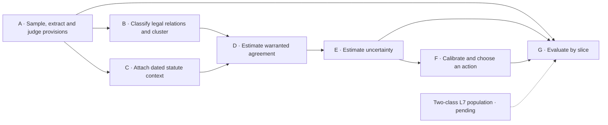

# JURIS-UQ

**Legal-aware uncertainty quantification for Indian legal question answering**

When a language model repeatedly cites the same provision, its answers may agree even when the provision belongs to the wrong legal regime. JURIS-UQ studies this common-mode error on 100 matched pairs of synthetic questions about the 1 July 2024 transition from the Indian Penal Code (IPC) to the Bharatiya Nyaya Sanhita (BNS). L1 asks for the pre-transition provision. L7 asks for the current provision, with the IPC citation as the trap.

In the frozen Qwen2.5-7B-Instruct run, all 16 L7 items with unanimous provision-level agreement were wrong. The project asks whether legal context can detect such errors and whether an uncertainty score can support a decision to answer, verify or abstain. The evidence supports the temporal diagnostic on this benchmark. The target population needed to evaluate error ranking on L7 is still missing. [Phase A results](runs/phaseA-laptop-v2-rejudged/e1_report.json) · [Current status](STATUS.md) · [Research roadmap](ROADMAP.md)

## How the system works



Phase A stores ten answers per question and resolves their asserted provisions. Phase B predicts five legal relation labels, including conditional equivalence. Rule-based evidence can block a merge when provisions contradict each other. The frozen Phase A entailment channel used a lexical proxy. Text similarity alone cannot establish legal equivalence. Phase C supplies validity windows, jurisdiction and IPC/BNS links. Phase D combines observed agreement with temporal validity, jurisdictional fit and contradiction mass to estimate warranted agreement. With all factors available, warranted agreement is `W = A × T × J × (1 − K)`. The common-mode score `A − W` measures how much observed agreement the legal context fails to support. A missing factor leaves the score undefined.

Phase E produces an **uncalibrated uncertainty score**, with a sample-only path when legal factors are missing. Phase F estimates reliability within an eligible stratum and applies a harm-weighted decision rule. On the frozen L7 stratum reliability is undefined and the policy returns `verify`. LSIM, Def-EVSE, WAD, IRIS and GRND belong to the proposed research architecture. The phase guides below identify the modules and experiments actually present.

## Evidence and gate outcomes

| Gate | Verdict | Finding and record |
|---|---|---|
| G1 | PASS | The final rejudged run scored 43/99 resolvable L1 majorities correct (one unresolved) and 0/100 on L7. The area under the receiver operating characteristic curve (AUROC) is undefined on single-class L7. The original naive-judge run remains as a methodological record. [Phase A](PHASE-A.md) |
| G2 | NOT YET | The v2 classifier reached macro-F1 0.9942 on 308 rule-labelled test pairs. Typed clustering rescued zero unanimously wrong collisions in either slice. [Phase B](PHASE-B.md) |
| G3 | NOT MET | The encoder probe measures pair merges. It cannot identify gold-side and trap-side effects separately, so the representation-safety criterion remains open. [Phase C](PHASE-C.md) |
| G4 | PASS | On 32 scorable collision records, separation AUROC was 0.9412 (95% CI 0.8529–1.0000). Fixing temporal validity at 1 reduced it to 0.5000. The earlier typed overlay has 13 unresolved records. The corrected Block 6b rehearsal yielded 172/200 defined common-mode scores. [Phase D](PHASE-D.md) |
| G5 | NOT_EVALUABLE | The L7 holdout contains only incorrect answers. The typed and exact-key comparisons on L1 and the attribution-controlled ablations remain separate analyses. [Phase E](PHASE-E.md) |
| G6 | NOT_MET | L1 cross-fitted absolute calibration error (ACE, five equal-width bins) was 0.2797 against a 0.05 limit. At 50% coverage, selective risk was 0.5455 versus 0.4545 for the sample-only baseline. Corrected conformal coverage was 15/22, down from 19/22 when the holdout also supplied the threshold. [Phase F](PHASE-F.md) |
| G7 | NOT_MET | No measured two-class L7 target population supports the headline comparison. The evaluation matrix reports L1 and L7 separately with reasons for undefined cells. [Phase G](PHASE-G.md) · [Evaluation matrix](runs/phaseG_eval_matrix.json) |

**API pilot: ON HOLD.** The provider returned HTTP 402. The pilot produced no model output. The independent local Qwen3-14B screens measure candidate yield. On 7 November 2026 the v2 L7 screen recorded 0/12 majority-correct items and 0/36 correct samples. All twelve L7 majorities were labelled `stale_law`. Its 12 L1 candidates remain unscreened by a real model. [Pilot status](runs/phaseG_pilot_status.json) · [Screen report](runs/phaseG_screen_v2_l7.json) · [Item records](runs/phaseG_screen_v2_l7_items.jsonl)

## Installation and offline validation

From the repository root with Python 3.11 or newer, create an environment and install the core dependencies. In PowerShell:

```powershell
python -m venv .venv
.\.venv\Scripts\Activate.ps1
python -m pip install -r requirements.txt
```

On a POSIX shell use `python3 -m venv .venv` and `source .venv/bin/activate` before installing the same requirements. The optional [Phase A requirements](requirements-phase-a.txt) support neural entailment. The [Phase B requirements](requirements-phase-b.txt) support encoder training and evaluation.

```powershell
python -X utf8 -m pytest -q
python -X utf8 scripts/46_revise_target_candidates_v2.py --check
python -X utf8 scripts/47_offline_check.py --out-dir "$env:TEMP/jurisuq-offline-check"
```

The candidate check rebuilds v2 in memory. The offline check verifies three content digests, analyses stored runs and exercises the screen with a mock provider. It writes reports in the selected scratch directory. Its mock echoes the gold answer, so its accuracy measures only harness behaviour. Software test counts and their environments are recorded in [STATUS.md](STATUS.md).

For read-only analysis, start with the linked JSON reports. Scripts that fit a model, analyse a run or render figures can write files even without inference. Historical reproduction commands naming frozen outputs belong in a disposable copy. For new generation, the operator must select a served model, a reachable endpoint and a fresh run ID. The committed [Phase A configuration](configs/phase_a.json) contains a placeholder model ID. The screen accepts `--slice L7` before the item limit, `--save-items` for per-item evidence and `--allow-generation` for an authorised real-provider run. [Screen harness](scripts/41_screen_target_yield.py)

## Repository and reading guide

| Location | Contents |
|---|---|
| [jurisuq](jurisuq/) · [scripts](scripts/) · [tests](tests/) | Research modules, numbered phase entry points and software checks |
| [data](data/) · [configs](configs/) | Frozen benchmark, rule-generated relations, statutes, candidate sets and experiment settings |
| [runs](runs/) | Run metadata, predictions, metrics, gate evidence and sibling runs recording corrections |
| [Deployment guide](DEPLOYMENT-GUIDE.md) | Operating modes, command examples and historical deployment instructions |
| [Stage 2](PHASE-G-STAGE2.md) | Candidate provenance and independent full, sliced and smoke screens |
| [L7 investigation](PHASE-G-L7-INVESTIGATION.md) · [Label review](reports/phaseG_l7_label_review_v1.md) | Per-item diagnostic, model attribution, source comparison and pending reviewer decisions |

## Scope and responsible interpretation

The frozen experiment covers one quantized checkpoint and one synthetic legal transition. Qwen3-14B screening provides single-model yield measurements on the specified candidate sets. Generalisation to other models, jurisdictions or real legal questions remains open. The detector primarily identifies temporal failures in this construction. Independent legal review of the statute rows and candidate labels is pending. JURIS-UQ is a research prototype and its outputs should not be used as legal advice.
