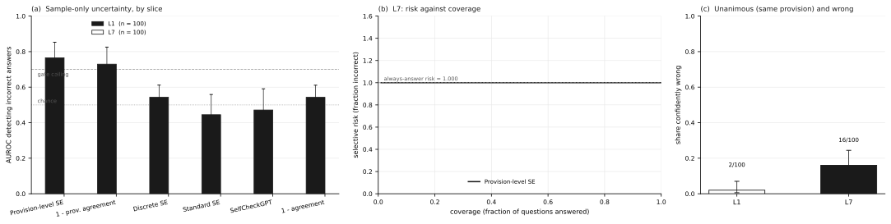
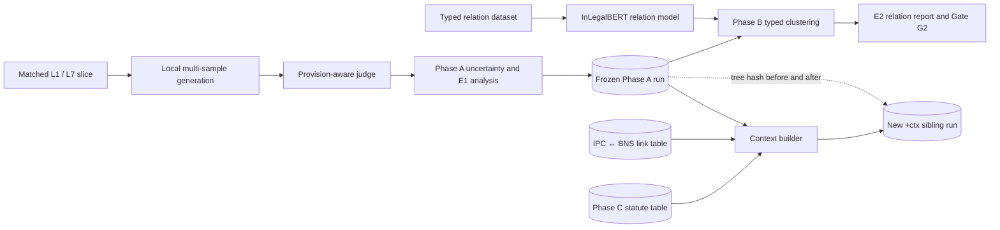

<div align="center">

# JURIS-UQ

### Legal-aware uncertainty quantification for LLM-based Indian legal question answering

[](https://www.python.org/)
[](#implementation-status)
[](#testing)
[](#phase-c-statute-store-and-context-packs)
[](#license)

**A research codebase for measuring when an LLM repeatedly gives the same legally wrong answer—and for enriching sample-based uncertainty with typed legal relations and time-aware statutory context.**

[Overview](#overview) · [Status](#implementation-status) · [Results](#results-at-a-glance) · [Installation](#installation) · [Reproduction](#reproducing-the-project) · [Limitations](#limitations-and-known-issues)

</div>

> [!IMPORTANT]
> This repository is a **research prototype**, not a legal research service and not a source of legal advice. Its datasets are scoped, partly synthetic, and not a complete statement of Indian criminal law. Phase C's software pipeline is implemented, but primary-source legal verification remains incomplete.

---

## Table of contents

- [Overview](#overview)
- [Research question](#research-question)
- [Implementation status](#implementation-status)
- [Results at a glance](#results-at-a-glance)
  - [Phase A: common-mode diagnostic](#phase-a-common-mode-diagnostic)
  - [Phase B: typed legal relations](#phase-b-typed-legal-relations)
  - [Phase C: statute store and context packs](#phase-c-statute-store-and-context-packs)
- [System architecture](#system-architecture)
- [Repository structure](#repository-structure)
- [Requirements](#requirements)
- [Installation](#installation)
- [Quick verification](#quick-verification)
- [Reproducing the project](#reproducing-the-project)
  - [Phase A](#phase-a)
  - [Phase B](#phase-b)
  - [Phase C](#phase-c)
- [Data and artefact contracts](#data-and-artefact-contracts)
- [Configuration](#configuration)
- [Metrics and decision gates](#metrics-and-decision-gates)
- [Testing](#testing)
- [Reproducibility and integrity rules](#reproducibility-and-integrity-rules)
- [Limitations and known issues](#limitations-and-known-issues)
- [Troubleshooting](#troubleshooting)
- [Documentation](#documentation)
- [Contributing](#contributing)
- [Citation](#citation)
- [License](#license)
- [Legal and research disclaimer](#legal-and-research-disclaimer)

---

## Overview

Most sample-based uncertainty estimators treat disagreement across an LLM's answers as evidence of uncertainty and agreement as evidence of confidence. Legal question answering exposes a dangerous failure mode in that assumption: a model can repeatedly cite the same repealed, inapplicable, or incorrect provision across every sample. The samples agree, but the agreement is not legally warranted.

JURIS-UQ studies this **common-mode legal error**. The repository currently implements three cumulative phases:

1. **Phase A — diagnostic instrument.** Build a matched pre-/post-transition legal QA slice, sample multiple answers, judge the asserted provisions, compute sample-only uncertainty statistics, and test whether those statistics detect repeated legal error.
2. **Phase B — typed legal relations.** Replace identity-only grouping with a five-way relation model and typed clustering, then re-cluster the frozen Phase A answers without modifying the original run.
3. **Phase C — legal context.** Add a deterministic statute store, validity windows, IPC↔BNS links, coverage reporting, and immutable context-packed copies of stored runs.

The current implementation focuses on the transition from the **Indian Penal Code, 1860 (IPC)** to the **Bharatiya Nyaya Sanhita, 2023 (BNS)**, effective **1 July 2024**.

### What this repository contributes today

- A resumable, OpenAI-compatible local sampling harness.
- A matched 200-item diagnostic slice spanning 10 offence clusters.
- Provision-aware answer extraction and correctness resolution.
- Discrete, entailment-based, and provision-level uncertainty statistics.
- Selective-prediction metrics: AUROC, AURC, normalized AURC, risk at coverage, ECE, bootstrap intervals, and Cohen's kappa.
- A deterministic five-class legal relation dataset and InLegalBERT classifier pipeline.
- Typed legal-semantic clustering with merge and blocking relations.
- A date-aware statute store with explicit `True` / `False` / `None` validity semantics.
- Context packs that report exactly how much of an answer set the statute store covers.
- Frozen, machine-readable Phase A–C artefacts and integrity hashes.

---

## Research question

JURIS-UQ begins with a narrow empirical question:

> **Can uncertainty methods that only inspect a model's own samples detect a shared legal mistake—and what happens when the correct law changes but the model's internal knowledge does not?**

The Phase A diagnostic uses matched question pairs:

| Slice | Time requested by the question | Gold authority | Deliberate trap |
|---|---|---|---|
| **L7** | Current law, after 1 July 2024 | BNS provision | Repealed IPC predecessor |
| **L1** | Law immediately before 1 July 2024 | IPC provision | Later BNS successor |

Each L7 item has an L1 counterpart with the same underlying facts and `pair_id`. This design isolates the legal-era change in the benchmark construction, while the results remain observational and model-specific rather than causal.

---

## Implementation status

Repository snapshot documented here: commit `e6a21a8` (`phase C: statute store, context packs, +ctx run (48 rows, 8 unresolved)`, 9 October 2026).

| Phase | Scope | Status | Run / artefact of record |
|---|---|---|---|
| **A** | Sampling instrument and E1 common-mode diagnostic | **Complete and frozen** | `runs/phaseA-laptop-v2-rejudged/` |
| **B** | Five-way relation model, typed clustering, and E2 re-clustering | **Implemented; run of record complete** | `runs/phaseB-relations-full/` |
| **C** | Statute store, legal links, validity lookups, verification workflow, and context packs | **Engineering complete; legal verification partially complete** | `runs/phaseA-laptop-v2-rejudged+ctx/` |

### Scope boundary

This README documents only the code and evidence implemented through **Phase C**. Later research modules described in the project guides are not represented here as completed functionality.

> [!WARNING]
> Phase C must not yet be described as fully legally verified. The repository records 40 of 48 rows with `verified: true` through the checklist workflow, but those 40 are supported by secondary references in the current audit. **No row was independently confirmed against accessible primary India Code or Gazette provision text in that environment**, and eight rows remain unresolved.

---

## Results at a glance

### Phase A: common-mode diagnostic

**Run of record:** `phaseA-laptop-v2-rejudged`  
**Generator:** Qwen2.5-7B-Instruct, Q4_K_M, served locally through an OpenAI-compatible LM Studio endpoint  
**Data:** 200 items (100 L1 + 100 L7), 10 samples per item  
**Sampling:** temperature `1.0`, top-p `1.0`, maximum `220` output tokens  
**NLI channel:** lexical proxy in the recorded run; the provision-level headline does not depend on that channel

| Measurement | L1 control | L7 current-law target |
|---|---:|---:|
| Items | 100 | 100 |
| Scored majority answers | 99 | 100 |
| Majority-answer accuracy | **0.434** | **0.000** |
| Provision-level collision population | 17 | 16 |
| Accuracy inside collision population | **0.882** | **0.000** |
| Risk at 50% coverage | method-dependent | **1.000 for every method** |

Key observations:

- All 100 scored L7 majority answers were wrong. AUROC is therefore **undefined**, not zero, because the slice contains only one correctness class.
- Sixteen of 100 L7 items entered the unanimous provision-level collision population; **16 of 16 were wrong**.
- The matched L1–L7 accuracy contrast was `+0.434`, with a bootstrap 95% interval of `[+0.333, +0.525]`.
- The difference in collision-population accuracy was `0.882` (L1 `0.882` minus L7 `0.000`).
- Gate **G1 passed** using the declared single-class fallback to the collision statistic.

The defensible interpretation is that, on this checkpoint and diagnostic slice, consistency across samples did not protect against a shared legal mistake. It is not evidence that all models, legal tasks, or uncertainty estimators behave identically.

<p align="center">
  
</p>

See [`docs/results_phase_a.md`](docs/results_phase_a.md) for the full result record, confidence intervals, gate logic, revision history, and freeze note.

### Phase B: typed legal relations

Phase B introduces the following operational relation labels:

- `SAME_PROVISION`
- `LEGALLY_EQUIVALENT`
- `CONDITIONALLY_EQUIVALENT`
- `DIFFERENT_PROVISION`
- `AMBIGUOUS`

The three first labels permit a typed-clustering merge. `DIFFERENT_PROVISION`, `AMBIGUOUS`, and computed contradictions block merging.

**Dataset:** `relations_v1`, 330 template-generated pairs  
**Split:** 198 train / 66 development / 66 test, topic-disjoint  
**Encoder:** `law-ai/InLegalBERT`  
**Run of record:** `phaseB-relations-full`, 3 epochs on CPU  
**Selected merge threshold:** `τ = 0.45`

| Test measurement | Result |
|---|---:|
| Macro-F1 | **0.7770** |
| Exact-key baseline macro-F1 | **0.7765** |
| Margin over exact-key baseline | **≈ +0.0005** |
| `SAME_PROVISION` operational merge precision | **0.8824** |
| Three-way merge F1 | **0.7545** |
| `DIFFERENT_PROVISION` recall | **0.0000** |

The learned model reached practical parity with the exact-key baseline while expressing graded relations that exact identity cannot represent. However, all six test errors were false merges: the classifier never predicted `DIFFERENT_PROVISION` for the six gold examples of that class.

#### E2 re-clustering of the frozen Phase A run

| Measurement | Result |
|---|---:|
| Phase A items re-clustered | 200 |
| Items whose clustering state changed | **130** |
| Encoder-scored pairs | 9,092 |
| Rule-decided pairs | 8,908 |
| Full CPU wall time | 1,282.5 s (≈21.4 min) |
| L7 exact collision population → typed collision population | 16 → **44** |
| L7 typed-collision accuracy | **0.0000** |
| L1 exact collision population → typed collision population | 17 → **62** |
| L1 typed-collision accuracy | **0.4516** |
| Items reclassified out of collision | **0** in both slices |
| Source Phase A tree hash before / after | identical |

Gate **G2 passed**, but its interpretation is deliberately conservative:

- the strongest condition was test merge precision `0.8824 ≥ 0.85`;
- the macro-F1 margin over exact-key identity was only about `+0.0005`;
- the separation condition passed because 130 item states changed;
- no exact collision was rescued, and the L7 collision population remained entirely wrong;
- collision AUROC was mechanically `0.5` because typed entropy was constant on the exact-collision subset.

Phase B therefore demonstrates a real change in the clustering layer, **not an improvement in correctness separation**.

See [`docs/results_phase_b.md`](docs/results_phase_b.md) for per-class scores, the confusion matrix, gate details, E2 analysis, and limitations.

### Phase C: statute store and context packs

Phase C adds deterministic legal context without a learned component:

- a closed-schema statute table;
- exact validity intervals with an exclusive `in_force_until` boundary;
- symmetric predecessor/successor links;
- base-section fallback for subsection lookups;
- coverage accounting for known and unknown asserted provisions;
- context-packed copies of frozen run records;
- source-tree hashing before and after context attachment;
- a CSV-driven human verification workflow.

#### Current statute-store state

| Measurement | Current value |
|---|---:|
| Total rows | **48** |
| IPC / BNS rows | **24 / 24** |
| Frozen offence clusters covered | **10 / 10** |
| Rows marked verified by the workflow | **40 / 48 (0.8333)** |
| Rows independently primary-source verified in the recorded audit | **0 / 48** |
| Unresolved rows | **8** |
| Current JSONL SHA-256 | `20c98b74c0855c5ec4c8cda2b2d52388ea5f3e8d2514376f56db425bdd90b21e` |
| Canonical no-overrides SHA-256 | `7be783e38c21effb24734a8be5400b9bd0c358d63130bb896aa13220ea09b61f` |

The eight unresolved rows concern four paired mapping/subsection decisions:

- `IPC 409` ↔ `BNS 316(4)` (secondary sources indicate that `316(5)` may be the correct public-servant/banker subsection);
- `IPC 468` ↔ root `BNS 336` (the excerpt may require `BNS 336(3)`);
- `IPC 344` ↔ `BNS 127(4)`;
- `IPC 345` ↔ `BNS 127(5)`.

The existing values are preserved until an accessible official source is inspected and the crosswalk convention is resolved.

#### Context-pack results

**Source run:** `runs/phaseA-laptop-v2-rejudged`  
**Output run:** `runs/phaseA-laptop-v2-rejudged+ctx`  
**As-of date:** `2026-10-01`  
**Jurisdiction:** `IN`

| Measurement | Result |
|---|---:|
| Packed items | **200** |
| Assertion lookups | **611** |
| Known lookups | **421** |
| Unknown lookups | **190** |
| Store coverage | **0.689034** |
| Excluded sentinel assertions | **17** |
| `in_force = False` entries | **492** |
| `in_force = True` entries | **208** |
| `in_force = None` entries | **190** |
| Gold/trap crosswalk relation | `successor_of` for all 200 items |
| Frozen source modified | **No** |

`None` is a first-class result: it means the store does not know the provision. It must never be converted to `False`, which would incorrectly label an unknown provision as stale law.

See [`PHASE-C-RESULTS.md`](PHASE-C-RESULTS.md) for the consolidated audit and [`PHASE-C.md`](PHASE-C.md) for the implementation and verification workflow.

---

## System architecture



### Component map

| Layer | Primary modules | Responsibility |
|---|---|---|
| Configuration | `jurisuq/config.py` | JSON run configuration and CLI overrides |
| Generation | `jurisuq/generators.py` | Mock and OpenAI-compatible local model clients |
| Normalisation | `jurisuq/normalize.py` | Conservative text normalisation and provision extraction |
| Judging | `jurisuq/judge.py` | Provision-based, LLM, and cascade correctness resolvers |
| Clustering | `jurisuq/cluster.py` | Discrete, lexical-proxy, and NLI entailment clustering |
| Metrics | `jurisuq/metrics.py` | AUROC, risk–coverage, AURC, nAURC, ECE, bootstrap intervals, kappa |
| Record pipeline | `jurisuq/pipeline.py` | Converts sampled outputs into immutable JSONL run records |
| Relations | `jurisuq/relations/` | Pair schema, synthetic data, classifier, typed clustering, relation statistics |
| Legal context | `jurisuq/context/` | Statute loading, validity lookup, link lookup, and context packing |

---

## Repository structure

```text
jurisuq_code/
├── configs/
│   ├── phase_a.json                 # real Phase A local-model configuration
│   ├── phase_a_smoke.json           # deterministic mock configuration
│   └── phase_b_relations.json       # relation dataset/model/E2 configuration
├── data/
│   ├── lexuq_slice.jsonl            # checked-in 200-item rebuilt L1/L7 revision
│   ├── lexuq_slice_summary.json
│   ├── relations/
│   │   ├── crosswalk_v1.jsonl       # IPC↔BNS links
│   │   └── relations_v1/            # train/dev/test JSONL + manifest
│   └── statutes/
│       ├── statutes_v1.jsonl        # 48-row generated table
│       ├── statutes_v1.manifest.json
│       ├── statutes_v1.overrides.jsonl
│       └── verification_checklist.csv
├── docs/
│   ├── results_phase_a.md
│   └── results_phase_b.md
├── jurisuq/
│   ├── cluster.py
│   ├── config.py
│   ├── facts.py
│   ├── generators.py
│   ├── judge.py
│   ├── metrics.py
│   ├── normalize.py
│   ├── pipeline.py
│   ├── relations/                    # Phase B
│   └── context/                      # Phase C
├── runs/
│   ├── phaseA-laptop-v2-rejudged/    # Phase A run of record
│   ├── phaseB-relations-full/        # Phase B reports (checkpoint excluded)
│   └── phaseA-laptop-v2-rejudged+ctx/# Phase C packed run
├── scripts/
│   ├── 00_...06_*.py                 # Phase A
│   ├── 10_...12_*.py                 # Phase B
│   └── 20_...22_*.py                 # Phase C
├── tests/                             # 112 collected tests
├── PHASE-C.md
├── PHASE-C-RESULTS.md
├── requirements.txt
├── requirements-nli.txt
├── requirements-relations.txt
└── run_phase_a.sh
```

> The Phase B checkpoint is intentionally excluded by `.gitignore`. `model.pt` is approximately 440 MB; the repository tracks its metadata and reports, not its weights.

---

## Requirements

### Base environment

- Python **3.11 or newer**; 3.11 or 3.12 generally has the widest binary-wheel compatibility.
- Git.
- Approximately 1 GB free space for the repository and base environment.
- Run commands from the repository root; this project is not packaged as an installable wheel.

### Dependencies by phase

| Scope | File | Main dependencies | Network / model requirement |
|---|---|---|---|
| Core + Phase A | `requirements.txt` | `requests`, `numpy`, `matplotlib`, `pytest` | None for tests or the mock generator |
| Optional standard semantic entropy | `requirements-nli.txt` | `torch`, `transformers` | Downloads the configured NLI checkpoint on first use |
| Phase B relation model | `requirements-relations.txt` | `torch`, `transformers`, `sentencepiece` | Downloads `law-ai/InLegalBERT` on first use |
| Phase C | none beyond base project | Python standard library | No runtime internet or learned model |

### Generator for a real Phase A run

Use one OpenAI-compatible local server:

- **LM Studio** (recommended for the recorded laptop workflow), or
- **llama.cpp** `llama-server`.

The supplied configuration expects `http://127.0.0.1:1234/v1` and a model identifier returned by the server's `/v1/models` endpoint.

---

## Installation

```bash
git clone https://github.com/RushikeshMasalkar/jurisuq_code.git
cd jurisuq_code
python -m venv .venv
```

Activate the environment:

```powershell
# Windows PowerShell
.\.venv\Scripts\Activate.ps1
```

```bash
# macOS / Linux
source .venv/bin/activate
```

Install the core environment:

```bash
python -m pip install --upgrade pip
python -m pip install -r requirements.txt
```

Optional NLI support for Phase A:

```bash
python -m pip install -r requirements-nli.txt
```

Phase B training/evaluation support:

```bash
# Install the PyTorch build appropriate for your CPU/CUDA/XPU platform first,
# then install the remaining declared dependencies.
python -m pip install -r requirements-relations.txt
```

For Intel Arc/XPU, CUDA, Apple Silicon, or CPU-specific PyTorch instructions, use the wheel source appropriate to the machine. Device selection in the Phase B configuration is automatic when `device` is empty: XPU → CUDA → MPS → CPU.

---

## Quick verification

From the repository root:

```bash
python -m pytest -q
```

Expected in a core-only environment:

```text
111 passed, 1 skipped
```

The skipped test is the torch-gated relation-model test. With compatible Phase B dependencies installed, the repository record reports:

```text
112 passed
```

Run the focused Phase C suite with:

```bash
python -m pytest tests/test_context.py -q
# 31 passed
```

Check the local generator configuration before a real Phase A run:

```bash
python scripts/00_env_check.py
```

To check only the Python environment without contacting a generator:

```bash
python scripts/00_env_check.py --skip-endpoint
```

---

## Reproducing the project

The multiline commands below use the POSIX `\` line-continuation character. In Windows PowerShell, place the command on one line or replace each trailing `\` with a PowerShell backtick (`` ` ``).

### Phase A

#### Re-analyse the shipped run of record

This does not generate new model answers:

```bash
python scripts/03_analyze_e1.py --run-id phaseA-laptop-v2-rejudged
python scripts/04_make_figure.py --run-id phaseA-laptop-v2-rejudged
```

The outputs are written to:

```text
runs/phaseA-laptop-v2-rejudged/e1_report.json
runs/phaseA-laptop-v2-rejudged/fig_e1.png
runs/phaseA-laptop-v2-rejudged/fig_e1.svg
```

#### Run the mock pipeline

```bash
bash run_phase_a.sh smoke
```

> [!CAUTION]
> The current `smoke` target calls `scripts/01_make_data.py --n-per-slice 40` and therefore rewrites `data/lexuq_slice.jsonl` as an 80-item slice. Use it in a disposable/clean worktree or restore the tracked 200-item slice afterward with Git. Running `python -m pytest -q` is the non-mutating plumbing check.

#### Run a new local-model experiment

A new run reads the checked-in `89bc1180…` slice revision. Give it a new run id and do not present it as a direct rerun of the earlier `45b2d194…` Phase A instrument.

1. Start LM Studio or `llama-server` on port `1234`.
2. Obtain the model id:

   ```bash
   curl http://127.0.0.1:1234/v1/models
   ```

3. Run the environment check and a small pilot:

   ```bash
   python scripts/00_env_check.py --model qwen2.5-7b-instruct
   python scripts/06_pilot.py \
     --config configs/phase_a.json \
     --run-id phaseA-pilot \
     --set model=qwen2.5-7b-instruct
   ```

4. Start a new resumable run:

   ```bash
   python scripts/02_run_inference.py \
     --config configs/phase_a.json \
     --run-id phaseA-my-run \
     --set model=qwen2.5-7b-instruct
   ```

5. Analyse and plot:

   ```bash
   python scripts/03_analyze_e1.py --run-id phaseA-my-run
   python scripts/04_make_figure.py --run-id phaseA-my-run
   ```

The inference script flushes each completed item to `items.jsonl`. Re-running the same command with the same run id resumes unfinished work instead of re-sampling completed records.

Useful overrides:

```bash
python scripts/02_run_inference.py --config configs/phase_a.json \
  --run-id phaseA-budget-run \
  --set model=qwen2.5-7b-instruct \
  --set n_samples=6 \
  --set max_tokens=160
```

Decide sampling settings before inspecting results and record all deviations from the supplied configuration.

#### Re-judge without re-sampling

A scoring change should reuse stored model answers:

```bash
python scripts/05_rejudge.py \
  --config configs/phase_a.json \
  --run-id phaseA-my-run \
  --out-suffix=-rejudged
```

Use `--inspect` for a report-only pass.

### Phase B

#### Verify or rebuild the relation dataset

```bash
python scripts/10_build_relations.py --verify-only
```

To regenerate `relations_v1` from the configured synthetic source:

```bash
python scripts/10_build_relations.py \
  --config configs/phase_b_relations.json \
  --source synthetic
```

The generated dataset has seven controlled strata:

| Stratum | Purpose |
|---|---|
| S1 | Same provision, easy paraphrase |
| S2 | Same provision, heavy paraphrase or reordering |
| S3 | Context-dependent, identical text under different contexts |
| S4 | Crosswalk-equivalent provisions across the legal transition |
| S5 | Hard negative: adjacent sections of the same act |
| S6 | Hard negative: same number, different act |
| S7 | Ambiguous act-only or truncated assertion |

#### Train a new relation model

```bash
python scripts/11_train_relation.py \
  --config configs/phase_b_relations.json \
  --run-id phaseB-relations-repro \
  --epochs 3
```

The checkpoint is written below `models/relation/` and is ignored by Git.

#### Evaluate the test split and run E2

```bash
python scripts/12_eval_relation.py \
  --config configs/phase_b_relations.json \
  --run-id phaseB-relations-repro \
  --phase-a-run phaseA-laptop-v2-rejudged
```

Faster diagnostic modes:

```bash
# Test metrics only
python scripts/12_eval_relation.py --run-id phaseB-relations-repro --skip-e2

# E2 on the first 10 Phase A items
python scripts/12_eval_relation.py --run-id phaseB-relations-repro --limit-items 10

# Rule-only plumbing path; no checkpoint
python scripts/12_eval_relation.py --run-id phaseB-rules-smoke --no-model --limit-items 10
```

A fresh clone cannot reproduce the learned Phase B report from the tracked reports alone because the 440 MB checkpoint is not committed. Train a new checkpoint or place the matching checkpoint at the configured path.

### Phase C

Phase C is deterministic and has no model dependency.

#### Build and validate the statute table

```bash
python scripts/20_build_statutes.py --out data/statutes/statutes_v1.jsonl
python -m pytest tests/test_context.py -q
```

The builder validates the closed schema, validity dates, duplicate keys, offence-cluster membership, consequence classes, symmetric links, and per-section window consistency. If the tracked overrides file exists, it is applied automatically.

Expected current post-override content hash:

```text
20c98b74c0855c5ec4c8cda2b2d52388ea5f3e8d2514376f56db425bdd90b21e
```

Check independently:

```powershell
# Windows PowerShell
Get-FileHash -Algorithm SHA256 data\statutes\statutes_v1.jsonl
```

```bash
# macOS / Linux
sha256sum data/statutes/statutes_v1.jsonl
```

#### Attach context without modifying the frozen source

Use a new suffix so the tracked `+ctx` run remains untouched:

```bash
python scripts/21_attach_context.py \
  --run-id phaseA-laptop-v2-rejudged \
  --out-suffix +ctx-repro \
  --as-of 2026-10-01
```

Outputs:

```text
runs/phaseA-laptop-v2-rejudged+ctx-repro/items.jsonl
runs/phaseA-laptop-v2-rejudged+ctx-repro/context_report.json
runs/phaseA-laptop-v2-rejudged+ctx-repro/meta.json
```

The command hashes the source run before and after packing and fails the integrity rule if the source changes.

#### Complete the legal verification workflow

```bash
# 1. Export or refresh the editable checklist
python scripts/22_verify_statutes.py --export

# 2. Compare every row with official enacted text and fill:
#    verified_ok, official_source, and notes

# 3. Convert the checklist into deterministic overrides
python scripts/22_verify_statutes.py --apply

# 4. Rebuild and re-test
python scripts/20_build_statutes.py --out data/statutes/statutes_v1.jsonl
python -m pytest tests/test_context.py -q
python -m pytest -q
```

Do not hand-edit the generated statute JSONL. The checklist is the human-editable evidence record; `statutes_v1.overrides.jsonl` is its machine-readable projection.

---

## Data and artefact contracts

### Frozen diagnostic slice

`data/lexuq_slice.jsonl` contains 200 records with, at minimum:

```json
{
  "item_id": "L7-culpable_homicide-004",
  "pair_id": "culpable_homicide-004",
  "slice": "L7",
  "era": "current",
  "question": "...",
  "gold": {"act": "BNS", "provision": "105", "label": "..."},
  "trap": {"act": "IPC", "provision": "304", "label": "..."},
  "distractor": {"act": "BNS", "provision": "103", "label": "..."},
  "provenance": {"verified": false, "transition_date": "1 July 2024"}
}
```

Two different 200-item revisions must be distinguished:

| Revision | SHA-256 | Meaning |
|---|---|---|
| Laptop-frozen Phase A instrument | `45b2d194e9c2f623457481c0d7d02f36c6267ec65c0b75ee3df2be4c0d1d010a` | Revision associated with the Phase A run of record |
| File currently shipped in this repository | `89bc1180a4df76287768ce59432aa7ff0aa9d38c16d5f296ed16c3e45449bd53` | Deterministic rebuild from the same seed after `facts.py` gained topics |

These files are **not byte- or experiment-interchangeable**. The engineering guide explicitly records this as open item O1. Do not compare a newly generated run with the frozen Phase A numbers unless the dataset digest is recorded and matches. Running `scripts/01_make_data.py` reproduces the shipped `89bc1180…` revision, not the laptop-frozen `45b2d194…` instrument.

### Phase A run record

Each line of `runs/<run_id>/items.jsonl` stores:

- item identity and question-side fields;
- the sampled answer texts;
- per-sample correctness and verdict labels;
- extracted asserted acts and provision keys;
- text-, entailment-, and provision-level clustering statistics;
- majority answer metadata;
- generation and scoring provenance.

`meta.json` records the model/provider, prompt, sample count, temperature, backend, judge, timing, configuration, and resume state.

### Phase B pair record

Every relation pair has deterministic identity, a topic-disjoint split, one of seven strata, two answer assertions, legal context, a closed relation label, provenance, and verifier state. The current dataset is rule-generated and has:

```text
content_hash = e1aa4ba0916cbc95e9e8edd93aba11a795c7ea66bde636aeb9b2bf4da8177674
```

### Phase C statute row

The statute table uses a closed 11-field schema:

```json
{
  "act": "IPC",
  "section": "302",
  "title": "murder",
  "text_excerpt": "...",
  "in_force_from": "1862-01-01",
  "in_force_until": "2024-07-01",
  "successor": "BNS 103",
  "predecessor": null,
  "offence_cluster": "murder",
  "consequence_class": "custodial",
  "verified": true
}
```

`in_force_until` is exclusive. For example:

```python
store.in_force("IPC 302", "2024-06-30")  # True
store.in_force("IPC 302", "2024-07-01")  # False
store.in_force("IPC 99999", "2024-07-01") # None: unknown, not stale
```

### Context pack

Phase C appends one registered field to a copied record:

```json
{
  "context": {
    "as_of": "2026-10-01",
    "jurisdiction": "IN",
    "crosswalk_relation": "successor_of",
    "validity": {
      "IPC 302": {
        "in_force": false,
        "window": ["1862-01-01", "2024-07-01"]
      },
      "BNS 103": {
        "in_force": true,
        "window": ["2024-07-01", null]
      }
    },
    "coverage": {
      "assertions": 2,
      "known": 2,
      "unknown": 0,
      "unknown_keys": []
    },
    "excluded_assertions": 0
  }
}
```

### Artefact registry

| Artefact | Producer | Purpose |
|---|---|---|
| `data/lexuq_slice.jsonl` | `scripts/01_make_data.py` | Matched L1/L7 diagnostic data |
| `runs/<id>/items.jsonl` | `scripts/02_run_inference.py` | Sampled and judged Phase A records |
| `runs/<id>/e1_report.json` | `scripts/03_analyze_e1.py` | Phase A metrics and Gate G1 |
| `runs/<id>/fig_e1.*` | `scripts/04_make_figure.py` | Paper-ready E1 figure |
| `data/relations/relations_v1/*` | `scripts/10_build_relations.py` | Phase B pair data and manifest |
| `models/relation/<id>/` | `scripts/11_train_relation.py` | Untracked relation checkpoint |
| `runs/<id>/relation_report.json` | `scripts/12_eval_relation.py` | Test metrics, E2, and Gate G2 |
| `data/statutes/statutes_v1.jsonl` | `scripts/20_build_statutes.py` | Validated statute store |
| `runs/<id>+ctx/` | `scripts/21_attach_context.py` | Context-packed sibling run |
| `data/statutes/verification_checklist.csv` | `scripts/22_verify_statutes.py` | Human verification evidence |

---

## Configuration

### Phase A

`configs/phase_a.json` controls:

- provider, base URL, model id, and API key;
- temperature, top-p, maximum tokens, retries, timeout, and workers;
- number of samples per item;
- clustering backend and entailment threshold;
- correctness judge and judge scope;
- included slices, item limit, and random seed.

Any top-level key can be overridden without editing the file:

```bash
python scripts/02_run_inference.py --config configs/phase_a.json \
  --run-id phaseA-custom \
  --set model=my-local-model \
  --set n_samples=8
```

### Phase B

`configs/phase_b_relations.json` controls:

- dataset version, source, split targets, and seed;
- encoder, device, epochs, batch sizes, learning rate, weight decay, dropout, and maximum length;
- merge threshold and development threshold grid;
- merge-precision, macro-F1, and separation gates;
- checkpoint and run directories;
- E2 source run and item limit.

The checked-in run of record used three epochs even though the current configuration now defaults to 12; the recorded loss was still declining at epoch three. Treat configuration changes as new experiments with new run ids.

### Phase C

Phase C deliberately has no learned-model configuration. Its explicit CLI inputs are the source run, output suffix, as-of date, jurisdiction, statute table, link table, run directory, and optional item limit.

---

## Metrics and decision gates

### Core metrics

| Metric | Meaning in this project |
|---|---|
| **AUROC** | Ability of an uncertainty score to rank incorrect answers above correct answers; undefined when only one correctness class is present |
| **Risk at coverage** | Error rate among the fraction of answers retained at a chosen coverage |
| **AURC / nAURC** | Area under the risk–coverage curve and its normalized form |
| **ECE** | Expected calibration error |
| **Semantic entropy** | Entropy over discrete or entailment-derived answer clusters |
| **Provision entropy** | Entropy over extracted asserted provisions |
| **Provision agreement** | Dominant asserted-provision share |
| **Collision population** | Items for which all samples resolve to one provision cluster |

### Gate G1 — Phase A premise

G1 asks whether sample-only methods fail on L7 and whether the L1/L7 contrast is visible. The intended criteria are:

1. best L7 sample-only AUROC at or below `0.70`; and
2. either an L1−L7 AUROC-gap interval excluding zero, or at least a 20-point difference in unanimously wrong share with non-overlapping intervals.

Because every scored L7 answer in the run of record was wrong, L7 AUROC was undefined. The implemented gate used its declared `collision-statistic` fallback and passed on the 16-of-16 unanimously wrong L7 collision population and the L1/L7 contrast.

### Gate G2 — Phase B relation layer

G2 passes only when all of the following hold:

1. test merge precision meets the configured minimum (`0.85`);
2. relation-model macro-F1 exceeds the exact-key baseline;
3. at least one configured E2 separation condition fires; and
4. the frozen Phase A tree hash is unchanged.

The run of record passed all four. The margin over the exact-key baseline was extremely small, and the separation condition reflected changed cluster assignments rather than rescued wrong collisions. These caveats are part of the result, not optional commentary.

---

## Testing

The repository currently collects **112 tests**:

| Test module | Collected tests | Coverage focus |
|---|---:|---|
| `tests/test_cluster.py` | 7 | Clustering and entropy |
| `tests/test_context.py` | 31 | Statute schema, boundaries, links, hashes, context packs, source immutability |
| `tests/test_data.py` | 5 | Diagnostic slice construction |
| `tests/test_e2.py` | 2 | Typed re-clustering behaviour |
| `tests/test_gate.py` | 7 | Gate logic, including zero and undefined cases |
| `tests/test_judge.py` | 15 | Provision extraction and verdicts |
| `tests/test_metrics.py` | 9 | Ranking, selective-risk, calibration, and intervals |
| `tests/test_normalize.py` | 6 | Legal text and provision normalization |
| `tests/test_pipeline_smoke.py` | 4 | End-to-end record construction |
| `tests/test_relations.py` | 26 | Pair schema, relation data, model path, typed statistics |

Current core-environment result:

```text
111 passed, 1 skipped in 1.71s
```

The one skip is expected when torch is not installed.

---

## Reproducibility and integrity rules

The implementation follows several hard rules from the engineering guide:

1. **No query-path component may read a correctness label.** Otherwise the output is not an uncertainty estimate.
2. **Frozen artefacts are read-only.** A later phase writes a new run id or sibling directory.
3. **Scoring changes re-judge stored samples; only prompt or item changes re-sample.**
4. **Single-class AUROC is reported as undefined.** It is never replaced by zero or chance.
5. **A measured zero is data.** Only a missing key is missing.
6. **Different prompt versions are not pooled in one result table.**
7. **Training data and test labels remain separated.** Phase B uses topic-disjoint splits and frozen hashes.
8. **Every reported number maps to a machine-readable file.**
9. **Estimates remain labelled as estimates until measured.**

The schema is additive: later stages may append fields and create new artefacts, but they must not rename, retype, redefine, or delete fields in frozen records.

---

## Limitations and known issues

### Scientific scope

- The main Phase A evidence comes from one quantized 7B checkpoint on one synthetic diagnostic construction. It does not establish model-family or domain-wide generality.
- L7 contains only incorrect majority answers in the run of record. This is itself an important failure result, but it prevents within-L7 AUROC estimation.
- The matched design supports a controlled contrast in the constructed benchmark; it does not license a causal claim about pretraining, model knowledge, or legal change.
- The repository implements a research instrument, not the complete production framework described in the broader project architecture.

### Data and labelling

- `data/lexuq_slice.jsonl` is synthetic from statute structure, not a naturalistic legal QA benchmark.
- The checked-in slice has digest `89bc1180…`, while the Phase A run of record names an earlier laptop-frozen revision with digest `45b2d194…`. The engineering guide says the crosswalk gained topics between those revisions; regenerate or compare only with an explicit dataset digest.
- The slice summary still records `crosswalk_verified: false`; Phase C improves the evidence trail but does not complete primary-source verification.
- The Phase B dataset is template-generated and structurally verified, not human-annotated. Its manifest records `human_verified_test: false`.
- The 66-item Phase B test split is small, and `DIFFERENT_PROVISION` has only six test examples.

### Model and evaluation

- The Phase A run of record used `nli_backend: lexical-proxy`, not the configured transformer NLI model.
- The Phase B classifier has zero recall on `DIFFERENT_PROVISION` in the frozen test report; every error is a false merge.
- The Phase B checkpoint is not tracked, so exact model re-evaluation requires the original checkpoint or retraining.
- Phase B's `+0.0005` macro-F1 margin over exact-key identity is too small to support a superiority claim.
- E2 changed 130 cluster states but rescued no exact collisions.

### Phase C legal verification

- The store covers only the 10 frozen offence clusters and provisions touched by the run; it is **not Indian criminal law as a whole**.
- Assertion coverage is `68.9%`; unknown keys must remain unknown.
- Forty rows have workflow-level verified flags based on the recorded checklist, but the audit categorizes them as secondary-source supported rather than independently primary-source verified.
- Eight rows remain unresolved across the IPC 409, IPC 468, IPC 344, and IPC 345 mapping pairs.
- Any correction to a frozen crosswalk requires a documented new revision, new hashes, rerun tests, and regenerated dependent artefacts.

### Repository packaging

- There is no `pyproject.toml` or installable package configuration; scripts are intended to run from the repository root.
- There is no declared CI workflow in the current tree.
- No license file is currently included.

---

## Troubleshooting

| Symptom | Likely cause | Resolution |
|---|---|---|
| `ModuleNotFoundError: jurisuq` | Command run outside the repository root | `cd` to `jurisuq_code` and rerun |
| Generator endpoint unreachable | LM Studio/llama-server is stopped, wrong port, or wrong URL | Start the server; check `curl http://127.0.0.1:1234/v1/models` |
| Configured model not found | `model` does not match the server's identifier | Pass `--set model=<exact-id>` or edit the config |
| NLI backend says `lexical-proxy` | Optional torch/transformers backend is unavailable | Install `requirements-nli.txt`; confirm the backend in `meta.json` |
| One relation test is skipped | torch is not installed | Expected in the core environment; install Phase B dependencies to run it |
| Phase B evaluation cannot find a checkpoint | `models/` is ignored and weights are not in Git | Train a new run or restore the matching checkpoint |
| Phase B E2 is slow | Pairwise encoder scoring on CPU | Use `--limit-items`, `--skip-e2`, a supported accelerator, or the rule-only smoke path |
| `ERROR: statute table not found` | Phase C builder has not run | Run `scripts/20_build_statutes.py` |
| Context output already exists | The suffix names an existing directory | Use a new `--out-suffix`; use `--force` only for a deliberate replacement |
| Statute hash is the no-overrides value | Overrides were disabled or absent | Confirm `statutes_v1.overrides.jsonl` exists and do not pass `--no-overrides` |
| Statute hash differs after verification edits | Verification flags or legal rows changed | Expected; record the new hash and rerun all dependent checks |
| Hash begins `4e1640e6…` | Pre-patch Windows CRLF serialization | Rebuild with the current scripts, which force LF line endings |
| L7 AUROC prints `None` / undefined | Every scored L7 answer has the same correctness class | Expected; use the declared collision-statistic interpretation |
| Smoke run makes tracked data dirty | `run_phase_a.sh smoke` rebuilds an 80-item slice | Run in a clean worktree or restore the frozen data files afterward |
| `SOURCE RUN CHANGED` | A supposedly frozen source run was modified | Stop, restore/re-clone the source, and investigate before using the output |

---

## Documentation

| Document | Purpose |
|---|---|
| [`docs/results_phase_a.md`](docs/results_phase_a.md) | Authoritative Phase A E1 result record and freeze note |
| [`docs/results_phase_b.md`](docs/results_phase_b.md) | Authoritative Phase B test/E2 result record and freeze note |
| [`PHASE-C.md`](PHASE-C.md) | Phase C implementation, commands, semantics, and verification workflow |
| [`PHASE-C-RESULTS.md`](PHASE-C-RESULTS.md) | Consolidated Phase C status, audit evidence, hashes, unresolved rows, and next actions |
| [`configs/phase_a.json`](configs/phase_a.json) | Real local-generator configuration |
| [`configs/phase_b_relations.json`](configs/phase_b_relations.json) | Relation-model and E2 configuration |
| [`data/relations/relations_v1/manifest.json`](data/relations/relations_v1/manifest.json) | Relation dataset hashes, counts, labels, and verification state |
| [`data/statutes/statutes_v1.manifest.json`](data/statutes/statutes_v1.manifest.json) | Statute-table counts, scope, verification share, and content hash |

---

## Contributing

Contributions should preserve the project's reproducibility contract:

1. Create a new branch and use a new run id for experimental outputs.
2. Do not modify frozen runs to make a later result easier to report.
3. Keep data/schema changes explicit and additive.
4. Add tests for every new field, metric, relation, or validity rule.
5. Record provenance and hashes for generated datasets and reports.
6. Run:

   ```bash
   python -m pytest -q
   ```

7. If statutory content or a crosswalk changes, cite the exact primary source inspected, regenerate the statute table and context packs, and update the relevant result note.

Large checkpoints should remain outside Git unless a release strategy with appropriate storage and licensing is established.

---

## Citation

No archival release or DOI is currently included. Until one is published, cite the repository and the exact commit used. A suggested software citation is:

```bibtex
@software{masalkar2026jurisuq,
  author  = {Rushikesh Masalkar},
  title   = {JURIS-UQ: Legal-Aware Uncertainty Quantification for LLM Legal Question Answering},
  year    = {2026},
  url     = {https://github.com/RushikeshMasalkar/jurisuq_code},
  note    = {Research software; cite the exact Git commit used}
}
```

For reported numbers, also cite the corresponding machine-readable file under `runs/` and the relevant phase result note.

---

## License

This repository currently contains **no `LICENSE` file**. Until the maintainer adds an explicit license, no open-source permissions should be assumed. Add a license before redistributing, modifying, or incorporating the code or data into another project.

---

## Legal and research disclaimer

JURIS-UQ is provided for research and educational use. It does not provide legal advice, does not replace consultation of enacted legislation or qualified counsel, and must not be used to make legal decisions. Statutory excerpts, provision mappings, model outputs, and derived labels may be incomplete or incorrect. Always verify legal claims against authoritative, current primary sources.
